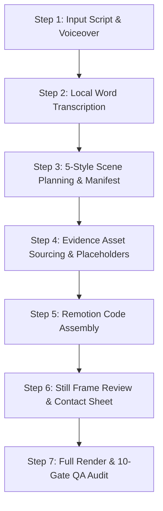

> [!IMPORTANT]
> NOT FOR HENA VANTA. Never use for the Hena Vanta channel.

# VantaBrief Video Production Workflow

This workflow defines the automated end-to-end pipeline for generating VantaBrief tech breakdown videos according to the **[VantaBrief Visual Style Bible](file:///D:/Automations/motion-studio/Channels/VantaBrief/style/VantaBrief_Visual_Style_Bible.md)**.

## Pipeline Sequence



---

### Step 1: Initialize Project & Place Audio
1. Run project creation:
   ```powershell
   python studio.py new "<video-title>" --channel VantaBrief
   ```
2. Place narration audio at:
   `Channels/VantaBrief/videos/<project>/assets/audio/voice/audio.mp3`
3. Optional human script at:
   `Channels/VantaBrief/videos/<project>/assets/audio/voice/script.txt`
   *(STRICT RULE R1: No SFX, no background music, no audio added).*

---

### Step 2: Offline Word-Level Transcription
Run faster-whisper locally with script alignment:
```powershell
python studio.py transcribe <project>
```
Outputs: `transcript.json` (word-level timestamps) and `aligned_script.json` (sentence & paragraph alignment).

---

### Step 3: 5-Style Scene Planning & Manifest
Run visual planner:
```powershell
python scripts/visual_planner.py <project>
```
- Segments narration into meaningful narrative units.
- Selects from the 5 Visual Styles (Kinetic typography, Real evidence, Editorial collage, Graphic symbols, Technical motion graphics).
- **Enforces Style 5 Special Rule**: Technical motion graphics are reserved primarily for explanations, systems, comparisons, and process logic.
- Generates `timeline/scenes.json` and logs any unsupplied assets in `manifests/footage-needed.md`.

---

### Step 4: Evidence Asset Sourcing & Placeholders
- Real product interfaces, official documentation, screenshots, and terminal commands are mapped to scenes.
- Any unsupplied footage or recording is assigned an explicit `<PlaceholderFrame>` with centered `FOOTAGE NEEDED` metadata and search terms.
- **Strict Rule R4**: NO human characters, stick figures, mascots, or cartoon people.

---

### Step 5: Remotion Composition Assembly
- Composes deterministic Remotion scenes using VantaBrief design tokens (`TOKENS` in `tokens.ts`) and modular primitives (`src/components/vantabrief/primitives/`).
- Palette: Charcoal `#231F20`, Cream `#FAF4D9`, Electric blue `#1677FF`, Amber `#F59E0B`, Crimson `#EF4444`, Emerald `#10B981`.
- Verifies zero lint/type errors (`npx tsc --noEmit`).

---

### Step 6: Representative Still Frame Review
- Renders still frames from opening, demonstrations, explanations, and conclusion.
- Generates a review contact sheet before committing to full render.

---

### Step 7: Full Production Render & QA Audit
```powershell
python studio.py render-remotion <project> VantaBrief-Episode-<num>
npx tsx scripts/qa.ts
```
Audits:
- Style Bible loaded check
- Narrative 5-style assignment & Style 5 explanation rule
- Approved palette compliance (no unauthorized hex codes)
- Character ban compliance (0 prohibited character assets)
- Footage placeholder integrity (all missing shots visible as `FOOTAGE NEEDED`)
- Real asset verification
- Audio integrity (0 SFX, 0 music, untouched voiceover)
- Contact sheet & visual inspection
