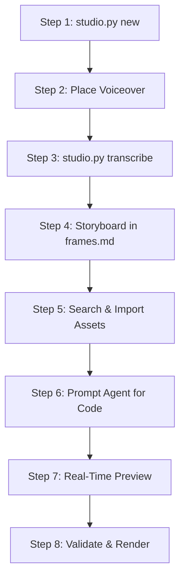

# The Motion Studio Master Guide
## How to Prompt AI Agents & Direct Professional Motion Graphics with Remotion and Manim

---

## Table of Contents
1. [The Philosophy & Architecture](#1-the-philosophy--architecture)
2. [The 8-Stage End-to-End Production Lifecycle](#2-the-8-stage-end-to-end-production-lifecycle)
3. [The 7-Layer Motion Prompting Architecture](#3-the-7-layer-motion-prompting-architecture)
4. [Prompt Recipes & Ready-to-Use Templates](#4-prompt-recipes--ready-to-use-templates)
   - [Recipe 1: High-Converting Kinetic Title Hook](#recipe-1-high-converting-kinetic-title-hook)
   - [Recipe 2: Apple-Grade Glassmorphic Metric / Stat Card](#recipe-2-apple-grade-glassmorphic-metric--stat-card)
   - [Recipe 3: Karaoke Kinetic Captions (Word-Level Audio Sync)](#recipe-3-karaoke-kinetic-captions-word-level-audio-sync)
   - [Recipe 4: Split-Screen Comparison Grid (Before vs After)](#recipe-4-split-screen-comparison-grid-before-vs-after)
   - [Recipe 5: Technical Architecture / Flowchart Animation in Manim](#recipe-5-technical-architecture--flowchart-animation-in-manim)
   - [Recipe 6: Transparent Lower Third / Overlay for NLEs](#recipe-6-transparent-lower-third--overlay-for-nles)
   - [Recipe 7: Full Explainer Video Assembly](#recipe-7-full-explainer-video-assembly)
5. [The Art of Iteration: How to Tweak & Debug Without Breaking Code](#5-the-art-of-iteration-how-to-tweak--debug-without-breaking-code)
6. [Motion Physics Cheatsheet: Springs, Interpolations & Timings](#6-motion-physics-cheatsheet-springs-interpolations--timings)
7. [Asset Library Workflows & Manifest Provenance](#7-asset-library-workflows--manifest-provenance)
8. [CLI Command Quick Reference](#8-cli-command-quick-reference)

---

## 1. The Philosophy & Architecture

Motion Studio pairs human creative direction with an agentic AI coder (Antigravity) and two code-driven rendering engines:
- **Remotion (React + TypeScript)**: Best for UI cards, dynamic typography, split-screens, counters, social videos, kinetic captions, and transparent overlays.
- **Manim Community (Python)**: Best for technical flowcharts, architectural diagrams, mathematical curves, algorithm step-throughs, and coordinate graphs.
- **Local Faster-Whisper**: Provides 100% offline, GPU-accelerated word-by-word timestamps from your narration audio without external API fees or privacy exposure.

### Mental Model: The Three Layers
```text
┌────────────────────────────────────────────────────────┐
│ 1. CREATIVE LAYER (You)                                │
│    - Ideas, manual voiceover, creative brief & style   │
└──────────────────────────┬─────────────────────────────┘
                           │ Prompts & CLI Commands
┌──────────────────────────▼─────────────────────────────┐
│ 2. AGENT & CODE LAYER (Antigravity)                    │
│    - studio.py orchestrator                            │
│    - React / Remotion components in remotion-app       │
│    - Python Manim scenes in manim-app                  │
└──────────────────────────┬─────────────────────────────┘
                           │ Render execution
┌──────────────────────────▼─────────────────────────────┐
│ 3. VIDEO LAYER (FFmpeg Renders)                        │
│    - High-res H.264 MP4 videos                         │
│    - ProRes 4444 Transparent MOVs                      │
│    - Direct import into Premiere, DaVinci, or CapCut   │
└────────────────────────────────────────────────────────┘
```

---

## 2. The 8-Stage End-to-End Production Lifecycle

Every video in Motion Studio follows an 8-stage sequence:



### Step 1: Initialize Project Scaffolding
Run from the workspace root (`D:\Automations\motion-studio`):
```powershell
python studio.py new my-video-title
```
This automatically scaffolds your canonical project folder under:
`Videos/my-video-title/`
with `assets/`, `transcripts/`, `manifests/`, `renders/`, `brief.md`, `style.md`, and `frames.md`.

### Step 2: Place Voiceover Narration
Record or export your narration audio and place it into:
```text
Videos/my-video-title/assets/audio/voice/narration.wav
```
*(Supports `.wav`, `.mp3`, `.m4a`, `.aac`).*

### Step 3: Run Local Faster-Whisper Transcription
Transcribe the voiceover offline using your NVIDIA GPU (with automatic CPU fallback):
```powershell
python studio.py transcribe my-video-title --model small
```
Outputs generated in `Videos/my-video-title/transcripts/`:
- `transcript.txt`: Plain readable script.
- `transcript.md`: Formatted scene timestamps.
- `transcript.json`: Machine-readable segments.
- `word-timestamps.json`: Millisecond-exact word timing for kinetic captions.
- `captions.json` & `captions.srt`: Subtitle tracks.

### Step 4: Storyboard & Script Breakdown
Open `Videos/my-video-title/frames.md`. Using the word timestamps from Step 3, write out the timing of each scene:
- `Scene 1 (0:00 - 0:04, frames 0-120)`: Hook title card + accent badge.
- `Scene 2 (0:04 - 0:12, frames 120-360)`: UI comparison grid (Before vs After).
- `Scene 3 (0:12 - 0:20, frames 360-600)`: Manim technical flowchart.

### Step 5: Search & Import Assets
Search indexed sound effects, music, or B-roll:
```powershell
python studio.py search-assets "whoosh" --category sfx
python studio.py search-assets "lo-fi" --category music
```
Import the chosen asset into your project with license tracking:
```powershell
python studio.py import-asset my-video-title "D:\Editor 2.0\SFX + Meme sounds\336 SFX\MIX\Fast whoosh.wav" --category sfx --license "owned"
```
The asset is copied to `assets/audio/sfx/Fast whoosh.wav` and registered in `manifests/sound-effects.json` and `manifests/assets.json`.

### Step 6: Direct the AI Agent (Prompting)
Open Antigravity (Ctrl+L) and paste your structured prompt (see Section 3 & 4) instructing the agent to build the Remotion composition or Manim scene.

### Step 7: Real-Time Preview
- **Remotion**: Open terminal and run:
  ```powershell
  cd projects/remotion-app
  npm run dev
  ```
  Open `http://localhost:3000` in your browser. Scrub the timeline, inspect frames, and test variations in real time.
- **Manim**: Render a low-quality fast draft:
  ```powershell
  python studio.py render-manim my-video-title my_scene.py ExplainerScene --quality l
  ```

### Step 8: Validate & Render
Run pre-flight validation to catch broken paths or missing assets:
```powershell
python studio.py validate my-video-title
```
Render final production-grade video:
```powershell
# Remotion Full Video (H.264 MP4)
python studio.py render-remotion my-video-title MyVideoComposition

# Remotion Transparent Overlay (ProRes 4444 with Alpha)
python studio.py render-remotion my-video-title TitleHook --transparent

# Manim High-Quality Scene (1080p60)
python studio.py render-manim my-video-title my_scene.py ExplainerScene --quality h
```
All finished files are saved in `Videos/my-video-title/renders/`.

---

## 3. The 7-Layer Motion Prompting Architecture

Vague prompts like *"Make a cool video about automation"* produce generic, unpolished layouts. Professional motion graphics require **Spec-Driven Prompting**. 

Always structure prompts using the **7 Layers**:

```text
┌────────────────────────────────────────────────────────────────────────┐
│ 1. TARGET & TOOL    → Remotion composition ID / Manim scene & filepath │
│ 2. CANVAS SPECS     → Resolution, FPS, exact duration (seconds/frames) │
│ 3. DESIGN SYSTEM    → Colors (HEX), typography, glassmorphism, radii   │
│ 4. SCENE TIMELINE   → Frame-by-frame / second-by-second choreography   │
│ 5. PHYSICS & EASING → Spring damping, mass, stiffness, overshoot       │
│ 6. AUDIO & SYNC     → Voiceover trigger frames, SFX hits, word stamps  │
│ 7. CONSTANTS CONFIG → Top-of-file config object for easy editing       │
└────────────────────────────────────────────────────────────────────────┘
```

### The 7 Layers Explained

1. **Target & Tool**: Specify Remotion or Manim, the file path (`projects/remotion-app/src/compositions/<Name>.tsx` or `projects/manim-app/scenes/<name>.py`), and registration in `Root.tsx`.
2. **Canvas Specs**: Width & height (1920x1080 for landscape, 1080x1920 for 9:16 Shorts/Reels/TikTok), FPS (standard: 30), and exact frame count (`durationInFrames = seconds * fps`).
3. **Design System**: Explicit hex colors (never say "blue" — say `#3B82F6` and `#1E293B`), typography (`Inter`, `Outfit`, `Fira Code`), glassmorphism (`backdropFilter: 'blur(20px)'`, `border: '1px solid rgba(255,255,255,0.1)'`).
4. **Scene Timeline**: Discrete chronological blocks:
   - *Seconds 0.0 - 0.5 (Frames 0 - 15)*: Background elements materialize.
   - *Seconds 0.5 - 1.2 (Frames 15 - 36)*: Main card slides up with spring overshoot.
   - *Seconds 1.2 - 2.5 (Frames 36 - 75)*: Number counter increments from 0 to 98%.
   - *Seconds 2.5 - 3.5 (Frames 75 - 105)*: Accent pulse and exit transition.
5. **Physics & Easing**:
   - Natural UI overshoot: `spring({ frame, fps, config: { damping: 12, mass: 0.6, stiffness: 120 } })`.
   - Smooth entrance: `interpolate(springVal, [0, 1], [40, 0], { extrapolateRight: 'clamp' })`.
   - Never use CSS transitions or `setTimeout`.
6. **Audio & Sync**:
   - Reference `Videos/<project>/transcripts/word-timestamps.json` or `transcript.json`.
   - Time animation beats to hit on stressed words.
7. **Constants Config**:
   - Require that all text strings, numerical values, and colors live in a single config object at the top of the file:
     ```tsx
     const CONFIG = {
       title: "AI Video Automation",
       statNumber: 84,
       statSuffix: "%",
       accentColor: "#6366F1",
     };
     ```

---

## 4. Prompt Recipes & Ready-to-Use Templates

Copy and adapt these battle-tested prompts directly into Antigravity (Ctrl+L).

---

### Recipe 1: High-Converting Kinetic Title Hook

**Use case**: First 3-5 seconds of YouTube/TikTok/Reels video to stop the scroll.

```markdown
Create a high-impact Remotion composition named "KineticTitleHook" for project "Videos/my-video-title".

1. SPECS:
   - Resolution: 1920x1080, 30 FPS, 120 frames (4.0 seconds total).
   - Target File: projects/remotion-app/src/compositions/KineticTitleHook.tsx
   - Register in projects/remotion-app/src/Root.tsx with id="KineticTitleHook".

2. VISUAL IDENTITY:
   - Background: Dark gradient from #0A0F1D to #020617 with subtle radial glow (#3B82F6 at 15% opacity).
   - Typography: Font 'Inter', sans-serif. Title: 72px bold (#F8FAFC). Highlight phrase: 72px bold gradient (#60A5FA to #A855F7).
   - Accent Badge: Pill badge at top "AUTOMATE YOUR WORKFLOW" in #38BDF8 with 1px border rgba(56,189,248,0.3) and dark glass background.

3. TIMELINE & MOTION:
   - Frame 0-15: Accent Badge scales up with spring(damping: 10, mass: 0.5) from scale 0.7 to 1.0 with subtle glow.
   - Frame 10-35: Line 1 ("Stop Editing Videos") slides up 50px with spring(damping: 12, mass: 0.6) and fades from 0 to 1.
   - Frame 25-50: Line 2 ("By Hand Every Day") pops in with spring overshoot (damping: 9, mass: 0.7).
   - Frame 45-80: An animated underline SVG path draws underneath "Every Day" using evolvePath / strokeDashoffset.
   - Frame 100-120: Gentle scale breathing effect (1.0 to 1.03) before cutting.

4. RULES:
   - Drive all motion using useCurrentFrame() and spring().
   - No CSS transitions or setTimeout.
   - Place all strings and colors in a top-level CONFIG object.
   - Check that the composition compiles and preview in Remotion Studio.
```

---

### Recipe 2: Apple-Grade Glassmorphic Metric / Stat Card

**Use case**: Explaining ROI, benchmarks, performance gains, or key metrics.

```markdown
Build a Remotion composition named "MetricStatCard" in projects/remotion-app/src/compositions/MetricStatCard.tsx.

1. CANVAS: 1920x1080, 30 FPS, 150 frames (5.0 seconds).
   Register in Root.tsx as id="MetricStatCard".

2. AESTHETICS:
   - Card dimensions: 620px width, padding 48px, border radius 28px.
   - Styling: Glassmorphism (background: rgba(30, 41, 59, 0.7), backdrop-filter: blur(24px), border: 1px solid rgba(255,255,255,0.12), box-shadow: 0 25px 50px -12px rgba(0,0,0,0.5)).
   - Palette: Background #030712, Primary text #F8FAFC, Muted text #94A3B8, Accent color #10B981 (Emerald).

3. CHOREOGRAPHY:
   - Frame 0-25: Card emerges from translateY(60px) to 0px and opacity 0 to 1 via spring(damping: 14, mass: 0.8).
   - Frame 15-60: Number counter animates smoothly from 0 to 87 using interpolate(frame, [15, 60], [0, 87], { extrapolateRight: "clamp" }). Round to nearest integer.
   - Frame 15-60: Simultaneously, a radial circular progress bar wraps around the metric ring from 0% to 87%.
   - Frame 40-70: Subtitle ("Turnaround Time Reduced") and supporting description ("Eliminated 14 hours of manual subtitle & cut alignment.") fade in and slide up 15px.
   - Frame 130-150: Smooth ease-out fade for scene transition.

4. CONFIG:
   Extract numberTarget: 87, suffix: "%", label: "Turnaround Time Reduced", and accentColor to a configurable object.
```

---

### Recipe 3: Karaoke Kinetic Captions (Word-Level Audio Sync)

**Use case**: MrBeast / Alex Hormozi style animated subtitles synced word-for-word to voiceover.

```markdown
Create a Remotion composition "SyncedCaptions" in projects/remotion-app/src/compositions/SyncedCaptions.tsx for project "Videos/my-video-title".

1. SPECS:
   - Resolution: 1080x1920 (9:16 Vertical format), 30 FPS.
   - Read word timings from the project's transcripts:
     import wordData from "../../../../Videos/my-video-title/transcripts/word-timestamps.json";
   - Voiceover audio:
     <Audio src={staticFile("audio/voice/narration.wav")} />

2. DISPLAY LOGIC:
   - Group words into readable chunks of 3-4 words.
   - For each word, calculate its start frame = word.start * fps, end frame = word.end * fps.
   - At the current frame, highlight the active spoken word:
     - Inactive words: Color #94A3B8, scale 1.0.
     - Active spoken word: Color #FACC15 (Yellow), scale 1.15 (bounced in with spring), drop-shadow 0 0 20px rgba(250, 204, 21, 0.6).
     - Background highlight: Rounded pill badge behind the active word in rgba(250, 204, 21, 0.15).

3. POSITIONING:
   - Placed at translateY(65%) so it sits in the lower third of the vertical phone screen.
   - Font: Extra bold sans-serif ('Outfit' or 'Inter'), 56px, uppercase.
   - Stroke: 2px text-stroke in #000000 for legibility against any background.
```

---

### Recipe 4: Split-Screen Comparison Grid (Before vs After)

**Use case**: Demonstrating manual vs automated workflow, old vs new, or problem vs solution.

```markdown
Create a Remotion composition "WorkflowComparison" in projects/remotion-app/src/compositions/WorkflowComparison.tsx.

1. SPECS:
   - 1920x1080, 30 FPS, 210 frames (7.0 seconds). Register in Root.tsx.
   - Layout: Two columns side-by-side (50% / 50% split) with a subtle vertical divider in rgba(255,255,255,0.1).

2. CONTENT:
   - Left Column ("The Manual Way"):
     - Header: "Manual Editing" with a red tag (#EF4444).
     - 3 Bullet points with red "✕" icons:
       1. "Hand-slicing pauses & dead air"
       2. "Typing subtitles word by word"
       3. "Searching 5 different asset folders"
   - Right Column ("The Motion Studio Way"):
     - Header: "Automated Studio" with an emerald tag (#10B981).
     - 3 Bullet points with green "✓" icons:
       1. "One-click local Whisper transcription"
       2. "Programmatic kinetic subtitle sync"
       3. "Auto-indexed external SFX & B-Roll"

3. CHOREOGRAPHY:
   - Frame 0-20: Left card slides in from left (-100px to 0) with spring(damping: 12).
   - Frame 25-50: Left bullet points stagger in (10 frame intervals).
   - Frame 60-80: Right card slides in from right (+100px to 0) with spring(damping: 12) and green outer glow.
   - Frame 85-115: Right bullet points stagger in with satisfying spring pop.
   - Frame 140-160: A bright highlight pulse sweeps across the right card.

4. Provide clean TypeScript interfaces for the comparison items.
```

---

### Recipe 5: Technical Architecture / Flowchart Animation in Manim

**Use case**: Complex technical explainers, data pipelines, software architecture, or math.

```markdown
Create a Python Manim scene named "PipelineExplainer" in projects/manim-app/scenes/pipeline.py for project "Videos/my-video-title".

1. SCENE REQUIREMENTS:
   - Class: PipelineExplainer(Scene)
   - Background: Dark (#0F172A).
   - Do NOT use LaTeX / MathTex (use standard Text to ensure offline portability).

2. DIAGRAM OBJECTS:
   - Three rectangular rounded nodes:
     1. Node A (Left): "Input Voiceover" (Color: BLUE, icon or label inside).
     2. Node B (Center): "faster-whisper (CUDA)" (Color: PURPLE).
     3. Node C (Right): "Remotion Compositions" (Color: GREEN).
   - Curved animated arrows connecting Node A -> Node B, and Node B -> Node C.

3. ANIMATION STEPS:
   - self.play(FadeIn(node_a, shift=UP), run_time=0.8)
   - self.play(Create(arrow_1), run_time=0.6)
   - self.play(FadeIn(node_b, scale=0.8), run_time=0.8)
   - self.play(Indicate(node_b, color=YELLOW), run_time=0.6) # show processing pulse
   - self.play(Create(arrow_2), run_time=0.6)
   - self.play(FadeIn(node_c, shift=RIGHT), run_time=0.8)
   - Create a glowing dot (Dot(color=YELLOW)) that travels along the arrows from Node A through Node B to Node C:
     self.play(MoveAlongPath(dot, arrow_1), run_time=1.0)
     self.play(MoveAlongPath(dot, arrow_2), run_time=1.0)
   - self.wait(2)

4. VERIFICATION:
   Test-render a draft using:
   python studio.py render-manim my-video-title pipeline.py PipelineExplainer --quality l
```

---

### Recipe 6: Transparent Lower Third / Overlay for NLEs

**Use case**: Rendering graphic overlays to drop directly onto DaVinci Resolve, Premiere Pro, or CapCut timelines.

```markdown
Create a transparent Remotion Lower Third composition "SpeakerBadge" in projects/remotion-app/src/compositions/SpeakerBadge.tsx.

1. SPECS:
   - 1920x1080, 30 FPS, 150 frames (5.0 seconds).
   - NO background element or fill (must remain 100% transparent alpha).
   - Positioned in bottom-left corner (bottom: 90px, left: 100px).

2. DESIGN:
   - Modern glass capsule badge:
     - Avatar/icon circle on the left with subtle glowing border.
     - Name: "Zakaria B." in 28px bold white.
     - Role: "Motion & Automation Architect" in 18px #38BDF8.
     - Capsule background: rgba(15, 23, 42, 0.85) with backdrop-filter: blur(16px), border: 1px solid rgba(255,255,255,0.15).

3. MOTION:
   - Frame 0-25: Capsule expands horizontally from 0 to full width with spring(damping: 13, mass: 0.6).
   - Frame 15-35: Text fades in and unmasks from left to right.
   - Frame 35-125: Rest / hold state with subtle shimmer on the border.
   - Frame 125-150: Capsule slides downward 80px and fades out.

4. EXPORT INSTRUCTION:
   Instruct user to render as ProRes 4444 transparent MOV using:
   python studio.py render-remotion my-video-title SpeakerBadge --transparent
```

---

### Recipe 7: Full Explainer Video Assembly

**Use case**: Assembling multi-scene full videos with background music, voiceover, and synchronized sequences.

```markdown
Build a master Remotion composition "FullExplainer" in projects/remotion-app/src/compositions/FullExplainer.tsx.

1. ASSETS INVOLVED (located in Videos/my-video-title/assets/):
   - Voiceover: assets/audio/voice/narration.wav (duration: 24.0 seconds = 720 frames).
   - Background Music: assets/audio/music/ambient-chill.mp3 (volume: 0.12).
   - Sound Effects: assets/audio/sfx/Fast whoosh.wav.

2. SEQUENCE TIMELINE (<Sequence> structure):
   - Sequence 1 (Frame 0 - 150, 0-5s):
     <TitleHook headline="The Future of Video Production" badge="MOTION STUDIO" />
     Trigger SFX whoosh at frame 0.
   - Sequence 2 (Frame 150 - 390, 5-13s):
     <WorkflowComparison />
   - Sequence 3 (Frame 390 - 570, 13-19s):
     <CalloutCard numberTarget={94} title="Time Saved" description="Automated timeline generation" />
   - Sequence 4 (Frame 570 - 720, 19-24s):
     <EndingCard ctaText="Start Automating Today" websiteUrl="motion-studio.local" />

3. GLOBAL LAYERS:
   - <LiquidBackground /> running continuously across all 720 frames.
   - <Audio src={staticFile("assets/audio/voice/narration.wav")} />
   - <Audio src={staticFile("assets/audio/music/ambient-chill.mp3")} volume={0.12} />
   - <KineticCaptions /> overlaying synchronized subtitles across the entire duration.
```

---

## 5. The Art of Iteration: How to Tweak & Debug Without Breaking Code

When refining motion graphics, **never ask the agent to rewrite everything**. Change one variable at a time using these proven iteration prompts.

### Adjusting Motion & Physics
> *"In `KineticTitleHook.tsx`, the card entrance feels too stiff. Change the spring configuration on line 28 to `damping: 10, mass: 0.5, stiffness: 140` so it has a more noticeable elastic bounce."*

### Adjusting Timing & Hold States
> *"In `MetricStatCard.tsx`, the counter starts too early. Shift the counter animation start from frame 15 to frame 30, and extend the total composition duration in `Root.tsx` from 150 to 180 frames so the viewer has an extra second to read the card."*

### Fixing Layout Collisions / Spacing
> *"On mobile 9:16 vertical mode, the caption badge is overlapping the lower third. Move the container style from `bottom: 120px` to `bottom: 260px` and clamp the maximum width to `85%`."*

### Troubleshooting Compilation Errors
If Remotion Studio shows a red error screen:
> *"Remotion compilation error in `CalloutCard.tsx`: `TypeError: Cannot read properties of undefined (reading 'fps')`. Please wrap `useVideoConfig()` at the root component level instead of inside the helper callback."*

---

## 6. Motion Physics Cheatsheet: Springs, Interpolations & Timings

### Frame Calculation Formula
```text
Total Frames = Duration in Seconds × FPS
At 30 FPS:
  0.5 seconds = 15 frames
  1.0 second  = 30 frames
  2.0 seconds = 60 frames
  5.0 seconds = 150 frames
  10.0 seconds = 300 frames
```

### Spring Physics Presets in Remotion
```tsx
// 1. Snappy UI Overshoot (Cards, Badges, Buttons)
spring({ frame, fps, config: { damping: 11, mass: 0.6, stiffness: 130 } })

// 2. Smooth & Elegant (Corporate, Minimalist, Lower Thirds)
spring({ frame, fps, config: { damping: 18, mass: 1.0, stiffness: 90 } })

// 3. Elastic & Bouncy (Cartoony, High-Energy Social Hooks)
spring({ frame, fps, config: { damping: 7, mass: 0.4, stiffness: 160 } })

// 4. Heavy & Cinematic (Large Titles, Hero Cards)
spring({ frame, fps, config: { damping: 22, mass: 2.0, stiffness: 80 } })
```

### Safe Clamped Interpolation
Always use `extrapolateRight: "clamp"` and `extrapolateLeft: "clamp"` to prevent visual glitches past the keyframe boundaries:
```tsx
const opacity = interpolate(frame, [0, 20], [0, 1], {
  extrapolateLeft: "clamp",
  extrapolateRight: "clamp",
});
```

---

## 7. Asset Library Workflows & Manifest Provenance

Your workspace has access to external asset libraries configured in `studio.json`:
- **SFX & Meme Sounds**: `D:/Editor 2.0/SFX + Meme sounds`
- **Music**: `D:/Editor 2.0/Music`
- **B-Roll Library**: `D:/Editor 2.0/B-Roll Library`
- **Icons**: `C:/Users/zakbi/Downloads/tag-icons`
- **Fonts**: `D:/Editor 2.0/Fonts`

### Searching & Importing Assets
1. **Search Indexed Files**:
   ```powershell
   python studio.py search-assets "riser" --category sfx
   python studio.py search-assets "drone" --type video
   ```
2. **Import into Project**:
   ```powershell
   python studio.py import-asset my-video-title "D:\Editor 2.0\SFX + Meme sounds\336 SFX\SWOOSHES\Deep swoosh.wav" --category sfx --license "royalty-free"
   ```
3. **Automatic Provenance Tracking**:
   The asset is automatically copied into `Videos/my-video-title/assets/audio/sfx/` and recorded in:
   - `Videos/my-video-title/manifests/sound-effects.json`
   - `Videos/my-video-title/manifests/assets.json`

---

## 8. CLI Command Quick Reference

| Action | Command |
| :--- | :--- |
| **System Health Check** | `python studio.py doctor` |
| **Create New Project** | `python studio.py new <project-name>` |
| **Local Whisper Transcription** | `python studio.py transcribe <project-name> [--model small]` |
| **Index External Asset Libraries** | `python studio.py index-assets [--all]` |
| **Search Asset Libraries** | `python studio.py search-assets "<keyword>" [--category sfx]` |
| **Import Asset into Project** | `python studio.py import-asset <project> <filepath> --category <cat>` |
| **Inspect Media (FFprobe)** | `python studio.py inspect-media <filepath>` |
| **Pre-Flight Project Validation** | `python studio.py validate <project-name>` |
| **Start Remotion Studio Preview** | `cd projects/remotion-app ; npm run dev` |
| **Render Remotion (MP4)** | `python studio.py render-remotion <project> <CompositionId>` |
| **Render Remotion (Alpha MOV)** | `python studio.py render-remotion <project> <CompositionId> --transparent` |
| **Render Manim Draft** | `python studio.py render-manim <project> <file.py> <Scene> --quality l` |
| **Render Manim Production** | `python studio.py render-manim <project> <file.py> <Scene> --quality h` |
| **Clean Build Artifacts** | `python studio.py clean [--all]` *(Guaranteed to preserve `Videos/`)* |

---
*(Created for Motion Studio on Windows 11 with NVIDIA GPU acceleration & Google Antigravity).*
